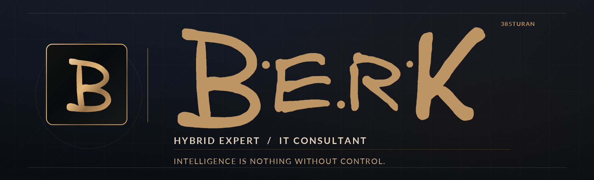

# Mustafa Berk

**Hybrid Expert — Logistics Excellence | IT Consulting**  
*Operational Digitalization · SCM Transformation · Aviation · Automotive*

I bridge the gap between **real-world operations and software engineering**. With more than two decades of experience in logistics and operational leadership, I focus on making complex processes simpler, more transparent, and digitally controllable.

## What I focus on

- **Logistics Excellence:** Operational stability, process improvement, and scalable execution.
- **Digital Transformation:** Turning operational requirements into practical digital tools.
- **Software Development:** Building a strong full-stack foundation and applying it to real-world use cases.
- **People & Learning:** Creating structured, interactive training and knowledge systems.

## Engineering journey

**Working with:** `HTML` · `CSS` · `JavaScript` · `Python` · `FastAPI` · `SQLite` · `Git` · `GitHub`  
**Building towards:** `React` · `Node.js` · modern full-stack application architecture

## Projects & areas of work

| Focus | What I'm building |
| --- | --- |
| **Training Technology** | Digital training, assessments, and interactive safety-learning experiences for industrial operations. |
| **Learning Labs** | Hands-on, browser-based development labs and offline learning tools. |
| **Operational Tools** | Digital workflows, dashboards, and structured process documentation. |
| **Frontend Engineering** | Responsive interfaces with accessible, maintainable HTML, CSS, and JavaScript. |

Explore my work in the [repositories](https://github.com/385turan?tab=repositories) section.

---

**Intelligence is nothing without control.**

[Website](https://mustafaberk.com) · [GitHub](https://github.com/385turan) · [Email](mailto:berk.mustafa@outlook.de)
